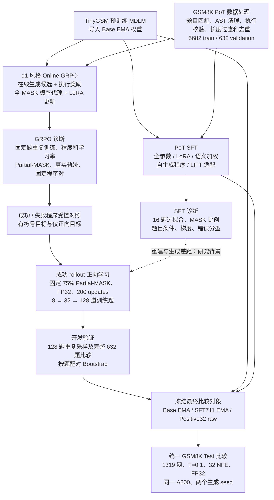
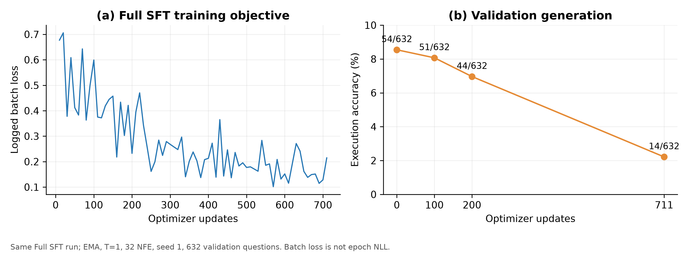
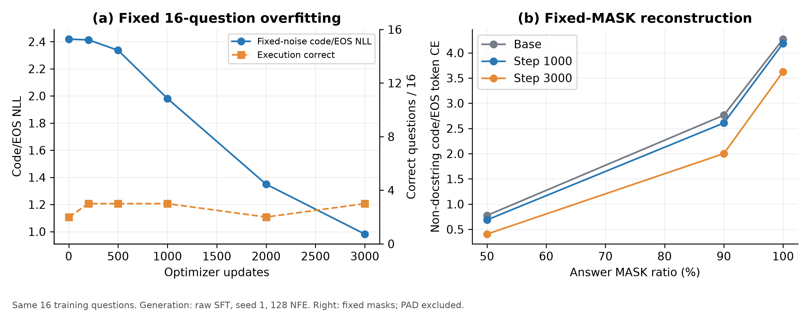
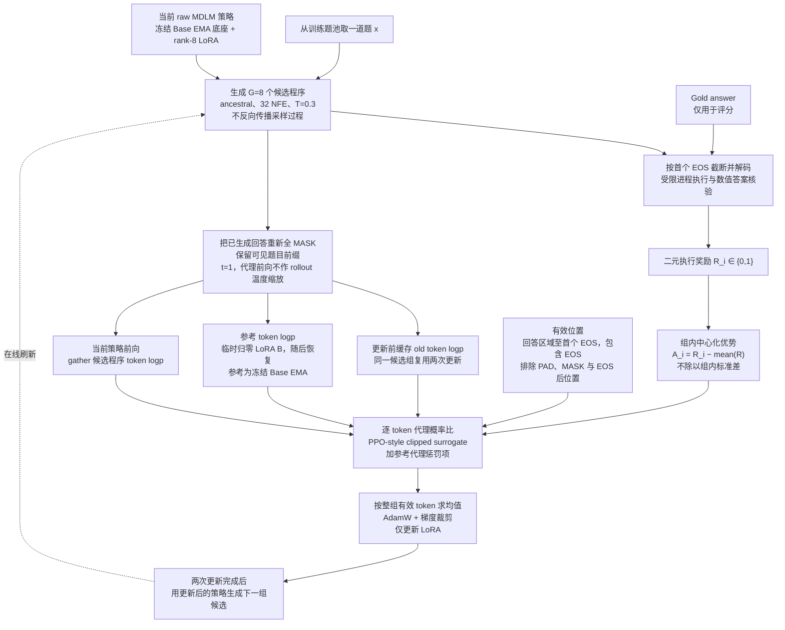
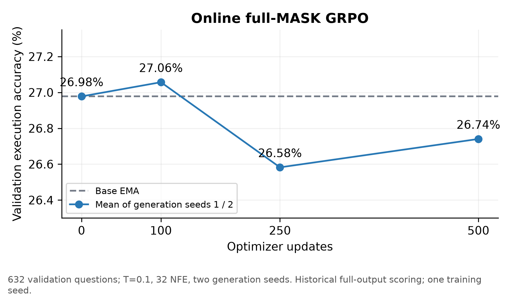
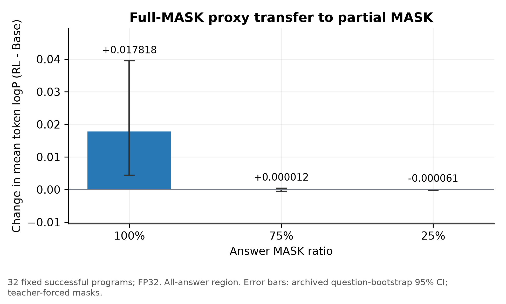
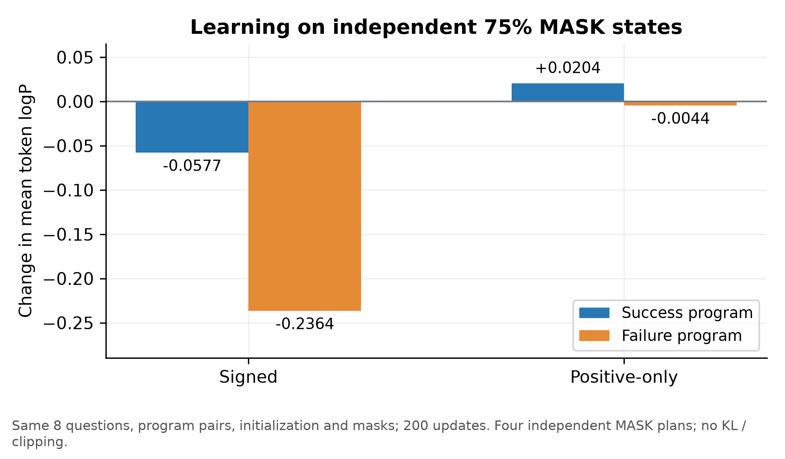
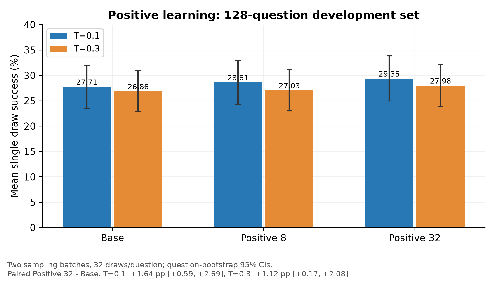
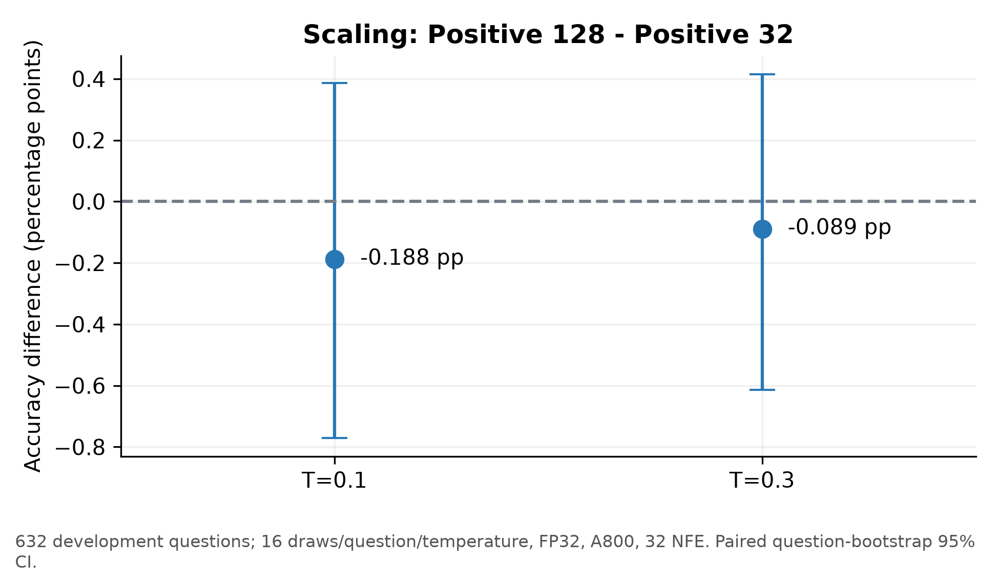

# TinyGSM MDLM 的 GSM8K 后训练：从 SFT、Online GRPO 到成功程序正向学习

> 最终实验技术报告 · 2026-10-26  
> 研究对象：s-flm 项目的 TinyGSM 预训练 MDLM。正文围绕实验决策展开，完整配置、运行入口及补充证据列于附录。图表来自已归档的真实日志和逐题结果。

## 摘要

本项目研究：预训练离散扩散语言模型能否通过 GSM8K 程序解答的监督微调与执行奖励优化，提高数学解题正确率。我先建立可执行、可核验的 PoT 数据及训练评测链路，再根据每轮结果逐步缩小问题范围：从 SFT 是否有效，转向重建改善是否能转化为生成收益；从在线 GRPO 是否有奖励信号，转向概率代理能否在真实去噪状态中迁移；最后用固定成功程序的正向学习，检验负优势项是否可能损害成功程序。

**本项目最主要的正向结果是：固定成功程序的75% Partial-MASK正向学习，将代理目标的改善推进到了validation上的实际生成收益。** 在128题validation子集、两批采样合并后，Positive32在T=.3下由Base的26.86%提高到27.98%，增益 **+1.12个百分点，按题配对95% CI为[+.17,+2.08]**；T=.1下由27.71%提高到29.35%，增益 **+1.64个百分点，CI为[+.59,+2.69]**。两种温度的配对区间均高于零。这是执行答案正确率的改善，测于与本地训练集去重后的validation题目，不仅是训练loss或参考程序评分的变化。

这一结果来自逐步诊断后的目标调整：Full SFT后期生成退化，LoRA缓解遗忘但未获得稳健净收益；在线GRPO有奖励差异且更新正常，增加预算仍未形成持续收益。受控对照发现，偏好差扩大可能主要来自失败程序评分下降；移除负向项后，成功程序在独立MASK上的评分得到改善，继而在validation生成中观察到正向收益。扩大到128道训练题未超过32题模型，界定了当前固定成功程序配方的扩量边界。

最终冻结 Base EMA、语义加权 SFT711 EMA 和 Positive32 raw，在同一 A800、完整1319题 Test、T=0.1、32 NFE、FP32、两个生成 seed 下比较，平均正确率分别为 **22.18%、22.14%、22.67%**。Positive32相对Base提高 **0.493个百分点**，按题配对95%区间为 **[−0.493，+1.516]个百分点**。因此，本报告同时保留两项结论：**Positive Learning在128题validation子集上获得了配对区间高于零的正向收益；完整Test的均值同样提高，但尚未确认稳定优于Base。** 前者限定于两批合并的开发评估，后者限定于最终统一benchmark，不能相互替代。

## 1. 研究问题与实验路线

数学程序解答适合本次研究：生成程序可由执行器评分，能够同时观察token重建、程序可运行性与最终答案正确性。选择现成TinyGSM MDLM而非重新预训练，使实验资源集中于后训练机制。这里使用的是仓库中的MDLM基线，不是将MDLM与连续Flow模型混为同一方法。

我按四个问题推进实验：

1. **基线是否测准？** 在讨论训练收益前，核对温度、权重类型和评估器口径。
2. **SFT到底学到了什么？** 将训练loss、条件重建与无参考答案的完整生成分开测量。
3. **RL无收益发生在哪一环？** 区分奖励不足、优化失效、代理改善不迁移，以及成功/失败程序评分同时下降。
4. **最小目标改动能否带来收益？** 在固定程序与MASK的受控条件下去掉负优势，再检验生成及覆盖扩展。

研究流程见下图。箭头表示研究推进，Positive Learning从Base EMA重新初始化，不从失败的SFT或GRPO模型续训。



这一路线的重点是让后续实验回答前一轮留下的具体不确定性。研究推进最终得到两类成果：一类是将SFT和在线GRPO的低收益拆解为可测的目标、优化与迁移问题；另一类是据此设计成功程序正向学习，**在128题validation子集上获得相对Base的正向生成收益**。随后增加采样、扩展题集并冻结最终比较，检验这一收益的可复现程度和适用范围。

## 2. 模型、数据与评估设置

### 2.1 模型与训练目标

MDLM通过吸收态MASK噪声破坏token，再预测原始token。使用DiT backbone，hidden size 768、12 blocks、12 attention heads；本实验总上下文长度为512，分词器为SmolLM-135M对应的固定revision。SFT和LoRA的底座均从发布checkpoint的EMA参数导入，重置后训练优化历史。

以$q(t)$表示遮盖概率，训练时可写为

$$
x_t\sim q_t(\cdot\mid x_0),\qquad
\mathcal L_{\mathrm{MDLM}}=\mathbb E_{t,x_t}\left[w(t)\sum_{j\in M_t\cap V}-\log p_\theta(x_{0,j}\mid x_t)\right],
$$

其中$w(t)$及归一化沿用实际MDLM实现，$V$由具体实验的loss mask决定。这一表达说明训练在不同噪声条件下恢复参考token，不能将其直接等同于完整程序的生成概率。代码/docstring/PAD权重变化时，跨实验总NLL也不再是同一指标。

生成从回答区域全MASK开始，按ancestral反向后验逐步恢复token，题目前缀每步固定。NFE是模型前向次数；最终比较使用32 NFE，并非自回归的32个输出token。两种条件的区别如下。


### 2.2 数据构建及分区

由14,591条MathInstruct GSM8K PoT记录出发，与原始GSM8K Train题目匹配，进行保守AST清理、执行及答案核验、长度过滤和同题去重，得到6314道合格题，再按题划分。

| 数据 | 题数 | 用途 |
| --- | ---: | --- |
| PoT train | 5682 | SFT、在线候选生成、固定成功程序筛选 |
| PoT validation | 632 | 开发比较；128题子集与其余504题均属该分区 |
| GSM8K Test | 1319 | 历史探索及最终冻结模型的统一benchmark |

实际输入为`BOS + question + separator + program + EOS + PAD`。separator使用配置中的字符串编码，并非新增`[SEP]`特殊token。gold数值只用于核验或奖励，不作为生成输入。已检查本地训练/验证的ID及规范化题面不重叠，PoT题池与Test也无发现的规范化题面重合；这不能证明预训练阶段没有暴露。

数据执行正确是必要条件，但不保证每个程序都表达了完全正确、可推广的数学过程。后续自生成程序实验另做小规模人工审核，也不能替代全量语义审计。

### 2.3 配置与比较原则

**Table 1. 关键实验配置。**列出主线配置；早期格式消融及诊断配置见附录。

| 实验 | 可训练参数 / 初始化 | 优化与预算 | 计算与设备 | 主要生成评估 |
| --- | --- | --- | --- | --- |
| Base-aligned Full SFT | 全参数 / Base EMA | LR=3e-6，batch 8，711 updates | BF16，A800 | validation 632，EMA，T=1，32 NFE，seed 1 |
| LoRA / 语义加权 SFT | rank 8、alpha 16、dropout .05 / Base EMA | LR=3e-6，batch 8，711 updates；warmup 20 | BF16；分阶段使用A800、Blackwell | 历史T=1；保留节点另做同机T=.1复评 |
| 自生成PoT与同题原PoT | 同上，190题同题对照 | LR=3e-6，200 updates | BF16，Blackwell | validation 632，EMA，T=.1，seeds 1/2 |
| 在线全MASK GRPO | rank 8、alpha 16、dropout 0 / Base EMA | LR=3e-6，G=8，每组复用2次；100或500 updates | BF16，Blackwell | validation 632，raw，T=.1，seeds 1/2 |
| FP32 / Partial75在线诊断 | LoRA / Base EMA | LR=3e-6或3e-5；250 updates | FP32，Blackwell | 固定32题，每温度每题16次 |
| Positive 8 / 32 / 128 | LoRA / Base EMA | LR=3e-5，200次全批次累积更新，microbatch 2 | FP32；8/32为Blackwell，128为A800 | T=.3/.1，每题16次；按轮次做新采样复评 |
| 最终Test | Base EMA / SFT711 EMA / Positive32 raw | 不训练；冻结三个模型 | FP32，同一A800，batch 8 | 1319题，T=.1，32 NFE，seeds 1/2 |

本文以程序执行答案正确率为主指标。raw parsing、execution、EOS行为和token CE仅用于定位问题。评估器包含代码提取、错误行前缀恢复及数值比较，涉及浮点时容差为$10^{-3}$；因此恢复后可解析率不能代替完整原始程序质量。最终Test同时保留raw结果，所有最终正确样本在raw口径下也正确。

历史Base在T=1、32 NFE下为76/1319，低温复评T=.1为303/1319。这次校准改变了对Base能力的判断：早先约5%的分数不能代表其低温表现。但两次测量也涉及不同硬件，不能将其作为严格单变量温度消融。最终统一比较使用本轮Base双seed结果，不以历史303题作为新模型对照。

所有小差异优先在同机、同题目顺序、同batch、同seed规则下比较。对重复采样，将每题成功次数除以采样次数后再按题Bootstrap；两个seed不等于两个独立题集，也不等于两个训练seed。Test曾被用于早期探索，最终比较披露这一历史，不称为完全未触碰测试集上的独立验证。

## 3. SFT：从“loss下降”到重建—生成差距

### 3.1 先建立可学习且可比较的监督目标

初始假设是：正确PoT程序能够把已有数学程序能力迁移到GSM8K。最初全参数训练围绕docstring、PAD监督及去噪/loss mask做了V1–V5调整，单seed、T=1的Test分数均低于Base。由于这些修改同时改变监督位置及输出格式，不能仅凭某一轮较低loss判定改进。

因此，下一步改为建立**与Base数据处理方式对齐的Full SFT对照**，固定题目前缀、原始docstring和PAD处理，保存100/200/711步，用生成准确率而非总loss判断进展。Full SFT的训练目标下降，但生成正确数为54→51→44→14；711步可解析数从614降到308，未闭合三引号增加到205条。



*Fig. 1. 同一Full SFT运行的实际batch loss及checkpoint生成结果。右侧为632题、T=1、EMA、32 NFE、单seed。日志仅有末期epoch NLL，故左侧不绘制不存在的逐节点Validation NLL曲线。*

这轮结果支持“当前Full SFT配方在后期破坏生成行为”，而不是“MDLM无法更新”。它引导我先限制参数改动：保持数据与优化设定，将更新方式改为rank-8 LoRA。LoRA的对应正确数为54/54/55/53，避免了Full SFT的大幅后期退化，但没有建立净提升。

### 3.2 SFT方法比较：稳定性改善不等于正确率改善

**Table 2. SFT主线结果，按协议分组。**以下为正文精选；全部节点见[完整SFT结果表](../tables/table_1.md)。同组内使用各轮同机Base，不跨组排名。

| 协议 | 模型 / 节点 | 正确数（seed 1 / seed 2） | 平均Accuracy |
| --- | --- | --- | ---: |
| A800，T=1，单seed | Base | 54 / — | 8.54% |
| 同上 | Full SFT 100 / 200 / 711 | 51 / 44 / 14（均seed 1） | 8.07% / 6.96% / 2.22% |
| 同上 | LoRA 100 / 200 / 711 | 54 / 55 / 53（均seed 1） | 8.54% / 8.70% / 8.39% |
| Blackwell，T=.1，单seed | Base | 179 / — | 28.32% |
| 同上 | 均匀权重LoRA200 | 177 / — | 28.01% |
| 同上 | 语义加权200 / 711 | 175 / 177（均seed 1） | 27.69% / 28.01% |
| Blackwell，T=.1，双seed；190题同题SFT | Base | 179 / 161 | 26.90% |
| 同上 | 原PoT200 | 180 / 162 | 27.06% |
| 同上 | 自生成PoT200 | 177 / 161 | 26.74% |
| A800，T=.1，双seed；LIFT对照 | Base | 177 / 165 | 27.06% |
| 同上 | A随机MASK200 | 176 / 164 | 26.90% |
| 同上 | B随机恢复200 | 180 / 161 | 26.98% |
| 同上 | C LIFT-3 200 / 711 | 180/163；177/162 | 27.14% / 26.82% |

随后每种改动对应不同假设，不能只按最终分数排列：

- **语义加权：是否把监督集中到计算相关位置就能改善数学答案？** 保持完整程序结构，关键数字、运算符和计算变量权重设为2，其余为1。711步保持了较好的语法稳定性，低温正确数仍低于Base。结论是当前启发式权重未形成生成收益，不是证明关键token监督无用。
- **自生成目标：参考程序分布与Base不匹配是否是主要问题？** 从512道训练题采样，筛选并人工排除歧义后，固定190题，各用原PoT和Base成功程序训练200步。自生成组未优于同题原PoT，排除了“换成这批成功程序就会改善”的简单解释；该结论限于190题、随机MASK、当前学习率与预算。
- **LIFT适配：改变代码区token遮盖选择是否能改善高噪声恢复？** 设置原随机MASK、随机恢复、LIFT-3三组控制。C200的双seed均值仅比Base多0.5题，C711也没有收益；固定MASK诊断仅有极小CE变化。这里验证的是代码/EOS区域的适配，不是原版LIFT全范围复现。

这些比较使我停止沿同配方延长训练。少量行为变化或CE改善不足以支持扩量；需要先判断模型究竟没有学到监督目标，还是学到的条件与生成要求不同。

### 3.3 用16题重复训练隔离“学不会”与“生成不受益”

我固定16道经人工核对的短程序训练题，LoRA重复训练到3000步，直接在这些已见题上生成。固定噪声code/EOS NLL从 **2.4187降到0.9818，下降约59.4%**；Base/200/500/1000/2000/3000步正确数却为 **2/3/3/3/2/3**。



*Fig. 2. 左：同一16题随机MASK实验，生成使用raw参数、seed 1、128 NFE。右：相同模型在固定50%/90%/100% MASK条件下，非docstring代码/EOS的token CE，排除PAD。它不是另一轮FP32全MASK code-only实验。*

NLL下降表明参数能够适应监督目标，但不能说明已获得程序级记忆。我进一步固定MASK比较：50% MASK下非docstring代码/EOS Top-1由88.35%到92.16%，而全MASK由26.91%到26.60%。全MASK CE也由4.2708降到3.6248，所以不能说全MASK“完全没有学习”；更准确的是，**分布评分改善没有转化为更多top-1命中，也没有使完整程序更容易生成正确**。

这引导后续诊断区分三个层面：

1. **条件恢复：**看到部分正确程序时，是否更容易补全其他token？
2. **全MASK预测：**只给题目时，初始token分布是否改善？
3. **多步生成：**模型实际访问的中间状态能否通向正确程序？

三者相关，但测量条件不同。尤其随机MASK提供了参考程序的信息；完整生成只能依赖题目和自身前面的预测。

### 3.4 排查替代解释，再转向执行奖励

为避免将所有负结果归结为一个猜测，我补做了以下检查：

- **题目条件：**以等token长度无关题替换前缀，全MASK下Base/step3000代码CE从4.2708/3.6248恶化到6.8598/6.2455，16/16题同向。模型确实利用题目，不支持“完全忽略题目”的解释。
- **更新通路：**梯度与参数检查未发现LoRA断开，冻结底座保持不变。FP32受控更新可降低CE，说明训练链路有效；不能由此断言BF16就是主因。
- **只监督代码：**FP32、全MASK、非docstring代码/EOS目标训练至3000步，CE由4.2704降到2.5318，但生成正确数由3/16降到0/16，出现三引号退化。单纯去掉其他监督区域未解决生成问题。
- **错误分类：**低温Base的632题中，有228个可执行但数值错误的程序；语义审阅将其中169归为建模错误、40归为缺步骤、15归为局部表达式错误、4归为歧义。该分类为单次助手审阅，未经独立复标，只用于提出假设。

这组证据将重点从“如何继续降低参考程序loss”转向“能否直接使用生成程序是否答对来更新”。但这一步只提出新的实验理由，并不预先保证执行奖励一定有效。

## 4. Online GRPO：奖励、优化与代理迁移的逐层诊断

### 4.1 适配方法与适用边界

我借鉴d1的概率代理思路，将执行奖励接入MDLM。每题在线生成8个候选，正确奖励1，错误奖励0；组内优势仅减均值，不除标准差：

$$
A_i=R_i-\frac1G\sum_{k=1}^{G}R_k.
$$

对生成回答重新全MASK，仅保留题目前缀，从MDLM输出gather回答token logp。定义$r=\exp(\ell_\theta-\ell_{old})$，$\delta=\ell_{ref}-\ell_\theta$，则实际目标为

$$
L=\operatorname{mean}_{(i,j)\in V}\left[-\min\left(r_{i,j}A_i,\operatorname{clip}(r_{i,j},1-\epsilon,1+\epsilon)A_i\right)+\beta\left(e^{\delta_{i,j}}-\delta_{i,j}-1\right)\right].
$$

$V$包括有效回答及首个EOS，排除PAD、MASK及EOS后位置。主实验$\epsilon=.2$、$\beta=.04$；按整组有效token平均，较长程序权重更大。每组缓存old/ref分数后复用两次，使用AdamW、weight decay 0、梯度范数阈值.2。参考模型通过临时归零LoRA B得到，底座为冻结的Base EMA。



这一适配没有计算32步去噪的精确轨迹likelihood，也没有反向传播采样链。rollout使用T=.3，代理前向不做同样温度缩放；参考项也不是完整序列KL。因此，代理ratio不能解释为真实生成策略的精确importance ratio。该边界决定了后续不能只凭proxy loss改善就宣布策略优化成功。

### 4.2 先审计奖励，再投入在线训练

若Base几乎生成不出正确程序，组内优势会频繁为零，直接训练的信息量有限。因此先在256道训练题上，每题生成8候选：2048个程序中有538个成功，175/256题同时含成功与失败候选。

审计说明这批题存在非零相对奖励信号，支持继续实验；它不保证信号足以覆盖全部题型。随后做独立100步初筛，再**从Base重新开始**500步实验。500次更新实际使用250个在线题组、2000个候选，每组复用两次，并未完整遍历5682题。

### 4.3 更新正常，但增加预算没有形成持续收益



*Fig. 3. 同一次独立500步运行，632题validation、T=.1、32 NFE、生成seeds 1/2，历史完整输出评分。Base/100/250/500步均值为26.98%/27.06%/26.58%/26.74%。独立100步初筛不混入此曲线。*

训练500次更新的loss、梯度和代理KL均有限，冻结底座校验通过，LoRA确实变化。然而100步的微弱正差没有延续到250/500步。这里能得出的结论是当前配方没有随预算增加形成持续净收益，不能证明所有MDLM RL均无效。

此时一个合理替代解释是**题目覆盖与复用不足**。我因此固定32道有混合奖励的训练题，重复在线训练，并将评估改为每题每温度16次。T=.3的成功次数为Base161/512、100步161、250步162、500步162；T=.1为183、185、183、183。pass@16接近饱和，未提供足够区分度，而单次成功率仍几乎不变。

这一步排除了“只因换题太快，所以完全没机会强化已见题”的简单解释；但固定32题仍是小样本，不能据此宣布强化已见题不可能。在线reward随题目与策略变化，不作为同题学习曲线。

### 4.4 固定程序受控拟合：目标能优化，但偏好差会误导

下一步不再依赖在线候选变化，固定8题、每题一成功一失败程序，使用相同MASK，对比BF16/FP32与LR=3e-6/3e-5。关闭KL与clipping，以回答“优化器能否改变代理目标”，而非评价正式GRPO收益。

四组均能提高成功−失败评分差。高学习率FP32组的差距增加约0.884，但成功logp从−1.2655降到−1.4225，失败logp从−1.2632降到−2.3040。**偏好差扩大主要伴随失败程序更大幅下降，成功程序自身并未增强。** 这提示只监测relative gap不足以判断正确程序更容易被生成。

FP32低学习率的改善大于BF16，因而我将FP32带回在线实验，并增加学习率对照。固定32题、250步时，高学习率组为T=.3的163/512、T=.1的188/512，对照为159/186；新增采样合并后，T=.3提升约.68 pp，区间[−.39,+1.86] pp，仍不能确认稳定收益。结论是数值精度值得检查，但不是已被证明的唯一瓶颈。

### 4.5 代理改善是否跨MASK条件迁移？

高学习率FP32在线模型的成功程序全MASK logp改善+.017818，但真实生成收益很小。我据此提出更具体的问题：训练代理优化的全MASK状态，能否代表多步生成过程中遇到的其他状态？



*Fig. 4. 固定32条成功程序，所有回答区域的mean token logp变化，误差线为按题95% CI。100%/75%/25% MASK分别为+.017818/+.000012/−.000061。部分MASK每程序使用4套固定掩码。*

随机Partial-MASK下变化很弱，但这仍是教师强制条件，可见token来自最终参考程序，且有重建上限效应。因此我进一步保存64条Base真实去噪轨迹，在第0/8/16/24/31步做只读评分：T=1评分的成功轨迹平均变化依次为+.023290、+.000300、+.000083、+.000099、−.000002。收益主要集中在起始全MASK状态，实际采样温度T=.3下没有稳定改善证据。

这支持代理与采样状态之间存在迁移不足的可能性，但不是唯一因果证明：轨迹只来自Base，目标是Base最终实现的token，不覆盖所有新策略状态。为进一步检验，我只改代理回答遮盖比例，做一组75% Partial-MASK在线GRPO；结果T=.3/.1为162/183，对照159/186，没有稳定收益。

Partial-MASK本身没有立即解决在线问题。独立MASK评分还发现成功与失败logp同时下降，差距略有增大。由此，下一步从“只改输入MASK”转向“拆开成功与失败的更新作用”。

### 4.6 Signed与Positive-only：把负向项变成可检验变量

我固定同一8题、同一成功/失败程序、同一训练MASK及4套独立MASK，保留成功优势+.5，只将失败优势从−.5改为0；原16程序分母不变，以保持成功项尺度。两组都从Base初始化、FP32、LR=3e-5、200次全批次更新，无KL/clipping。



*Fig. 5. 200步相对初始状态，独立75% MASK上的mean token logp变化。Signed成功/失败分别−.05774/−.23641；Positive-only为+.02039/−.00441。*

正向目标在独立MASK上7/8题成功评分提高，按题95%区间[+.00545,+.04114]；失败评分变化区间包含零。该对照比单纯调学习率更有解释力：同样的成功项、初始化与程序，仅移除负向项，就避免了这组实验后期成功评分下降。

它支持“负向项可能参与成功程序受损”的局部解释，但仍不能推广为所有负优势学习有害，也不是对在线GRPO的完整因果消融。这一受控结果足以支持下一步检验真实生成，尚不足以直接宣布Positive Learning有效。

## 5. 成功程序正向学习：validation正向收益及其验证边界

### 5.1 方法定位：从目标诊断转向固定成功程序学习

Positive Learning使用Base生成且执行正确的固定程序，保留题目条件，固定约75%的有效回答token为训练MASK，非回答尾部仍遮盖。采用FP32、rank-8 LoRA、LR=3e-5、AdamW、microbatch 2、梯度范数阈值.2；每次累积全部训练程序的梯度，共200次更新。

8/32题对照沿用原成功/失败配对分母，失败程序只评估，不贡献损失；成功项等价于

$$
L_+=-\frac{0.25}{N}\sum_{i=1}^{N}\frac{1}{|M_i|}\sum_{j\in M_i}\log p_\theta(y_{i,j}\mid x_i,\widetilde y_i).
$$

128题扩量保留相同成功项尺度。该方法属于固定成功rollout的选择性正向学习/蒸馏：没有在线候选刷新、组内优势重估、clipping或KL。它与前面的自生成PoT SFT也不同，MASK、精度、学习率、预算及题池均发生变化；不能将后续收益唯一归因于其中某一项。

从8题扩到32题时，每程序仍参与200次更新，总成功程序计算量增加。第50/100/200步保存节点，仅预设200步进入主要生成比较，不根据开发分数挑最佳checkpoint。训练及独立MASK评分曲线见[附录图A1](../figures/appendix_a1_positive_training.pdf)。独立MASK是相同训练程序上的新掩码，不是独立测试题。

### 5.2 128题validation子集：相比Base获得正向生成收益

为避免只在8道拟合题上判断，我从632题validation按固定哈希选128题，核对与完整本地训练集无ID/规范化题面重叠。每题在T=.3/.1各采样16次。首批Positive32优于Base后，我补评Positive8，并为三个模型增加同题新seed采样，检查差异是否依赖原批次。



*Fig. 6. 原批与新批合并，每题每温度32次，128题共4096次生成/模型/温度。Positive32相对Base在T=.3/.1分别提高1.12/1.64个百分点，两温度的配对95% CI均高于零。柱误差线为单模型按题CI；模型间判断使用图下注明的配对差值CI。*

**两批合并结果显示，Positive32在两个温度下均提高了相对Base的平均单次生成成功率，按题配对95%区间均不包含零。** 具体结果为：

- **T=.3：**Base / Positive8 / Positive32为26.86% / 27.03% / 27.98%；Positive32−Base为 **+1.12 pp [+.17,+2.08]**。
- **T=.1：**三者为27.71% / 28.61% / 29.35%；Positive32−Base为 **+1.64 pp [+.59,+2.69]**。

这是本项目从目标诊断走向实际生成改善的关键进展：此前SFT和在线GRPO主要观察到重建学习、参数变化或不确定的小差异，而这次在未用于本地训练的validation题目上，获得了两个温度均为正的配对结果。它支持将成功程序正向学习保留为后续主线，并引导下一步检验更多题目上的覆盖效果和最终benchmark。

这一正向结论有明确范围。新批**单独**比较仍为正向点估计，但区间均含零：T=.3为+.44 pp [−1.07,+1.90]，T=.1为+1.32 pp [−.10,+2.69]。因此应写成“128题validation子集上、两批合并后观察到正向生成收益”，不能扩大为独立新批已单独确认收益、全部632题均优于Base或多训练seed复现成功。两批采样增加的是同题测量精度，并未增加独立题目。

为检验8→32的覆盖扩展，我进一步在其余504题上同机比较两个模型，每题16次。T=.3差值为+.806 pp，CI[+.161,+1.426]；T=.1为+.570 pp，CI[−.012,+1.116]。该轮没有Base，故只能支持32题模型相对8题模型在主指标上的改善，不能用来声称它在504题上优于Base。随着这些比较完成，整个632题都应视为已使用开发集。

### 5.3 32→128题扩量：训练评分改善不保证规模收益

32题正向模型成为工作基线后，下一步检验是否仅需更多成功程序。保留原32条，按固定候选顺序让Base为新增题每题生成8个程序；尝试151道候选题、1208个程序后，找到96道有成功程序的新题，合并为128条。独立核验确认128/128程序原始执行正确，题目及gold与训练源一致，无超长截断，与validation无ID/题面重合。

训练保持200次更新、75% MASK和成功项尺度，原32条沿用相同训练与独立MASK；总成功程序计算量约增至4倍。训练及独立MASK评分都有改善。随后只比较预设200步模型与现有Positive32，在同一A800、完整632题、每题每温度16次采样，共40448条输出。



*Fig. 7. Positive128−Positive32，T=.1为−.188 pp，95% CI[−.771,+.386]；T=.3为−.089 pp，CI[−.613,+.415]。两模型同机、同题、同采样规则。*

两温度都未确认额外收益。该结果使我停止继续单纯增加这套固定程序训练题数，转向统一最终评估。它不证明更多成功数据必然无效，也不证明两模型等效：新增题、程序分布及总计算量同时变化，只有一个训练seed，且置信区间仍允许小幅正负差异。

### 5.4 完整Test：冻结对象后检验开发结论

最终比较对象固定为Base EMA、语义加权SFT711 EMA和Positive32 raw。SFT711是完整数据SFT中保留的代表性诊断候选，兼顾稳定性与行为变化，不能称为已证明最优的SFT；Positive32是在开发比较后保留的工作基线。三者在同一A800、相同题目顺序、batch 8、FP32、T=.1、ancestral 32 NFE、生成seeds 1/2下评估全部1319题，合计7914条输出。不同模型共享按batch确定的seed规则，记录tokenizer、前缀、sampler与实际backbone dtype审计。

**Table 3. 最终GSM8K Test统一比较。**单模型CI按每题两seed平均值、10000次按题Bootstrap计算；配对CI使用归档比较结果。

| 模型 | Seed 1正确 /1319 | Seed 2正确 /1319 | 平均Accuracy | 按题95% CI |
| --- | ---: | ---: | ---: | --- |
| Base EMA | 300 | 285 | 22.18% | [20.39%,24.03%] |
| SFT711 EMA | 298 | 286 | 22.14% | [20.32%,23.96%] |
| Positive32 raw | 294 | 304 | 22.67% | [20.85%,24.49%] |

| 配对比较 | 平均差值 | 95% CI（百分点） |
| --- | ---: | --- |
| SFT711−Base | −.038 pp | [−.417,+.341] |
| Positive32−Base（主要比较） | +.493 pp | [−.493,+1.516] |
| Positive32−SFT711 | +.531 pp | [−.531,+1.630] |

Positive32均值最高，但两个seed分别比Base少6题、多19题，合并配对区间含零。**最终结果不支持“已稳定超过Base”的强结论，也不能反过来证明方法没有任何效果。** 主要区间既允许约.49 pp退化，也允许约1.52 pp提升，显示当前证据的分辨率仍有限。SFT同样没有显示收益。

validation与Test在这里回答不同层次的问题：**128题validation子集上已观察到配对区间高于零的生成收益；最终Test上点估计保持正向，但区间含零，尚未确认该收益能够稳定推广。** Test结果限定了推广结论，并不否定已经测得的validation收益；同样，validation收益也不能替代最终benchmark的证据。两个开发温度不能直接与最终单温度结果拼接。最终Test有历史探索性使用，不包装成完全独立、未触碰测试集的证明。

最终对比图另见[附录图A2](../figures/appendix_a2_final_test_comparison.pdf)，原始记录与审计见[最终Test证据](../final-test-20261026-01/)。

### 5.5 计算开销与工程有效性

**Table 4. 计算开销。**训练时间是对应session日志的累计batch计时及含验证wall时间；不含下载、环境配置和全部历史评估。峰值为PyTorch allocated，不是设备总占用。完整逐运行表见[计算开销表](../tables/table_4.md)。

| 训练运行 | GPU | 本session有效更新 | batch累计(s) | 含验证wall(s) | 峰值allocated(MiB) |
| --- | --- | ---: | ---: | ---: | ---: |
| Base-aligned Full SFT | A800 | 711 | 79.08 | 82.88 | 9633.2 |
| 语义加权SFT | RTX PRO 6000 Blackwell | 711 | 47.67 | 50.34 | 9392.9 |
| 同题原PoT SFT | Blackwell | 200 | 13.26 | 27.04 | 9408.1 |
| 自生成PoT SFT | Blackwell | 200 | 13.11 | 26.81 | 9408.1 |
| LIFT C200 | A800 | 200 | 26.41 | 31.60 | 7870.2 |
| LIFT C200→711续训 | A800 | 511 | 61.79 | 74.33 | 7870.2 |
| Online GRPO / Positive Learning | 按轮次Blackwell或A800 | 500 / 各200 | 未统一提取直接计时 | 未统一提取直接计时 | 所选摘要未记录 |

| 最终Test评估 | 耗时(s) | 峰值allocated(MiB) | 峰值reserved(MiB) | 计时范围 |
| --- | ---: | ---: | ---: | --- |
| Base EMA | 1162.59 | 3680.1 | 7058.0 | 完整双seed，2638条 |
| SFT711 EMA | 1157.02 | 3646.8 | 7058.0 | 完整双seed，2638条 |
| Positive32续评 | 473.77 | 3652.2 | 11368.0 | 仅新增1061条及恢复批次重生成 |

评估计时包含生成与执行评分，不含模型加载。Positive32中断前完整精确计时缺失，不能用7.90分钟与另两者完整19分钟直接比较。大规模重复采样的生成与执行成本是本项目的重要开销，不能只列几十秒SFT训练而暗示整个研究成本很低。

最终Test曾在Positive32第二seed的第259题中断。复现得到一个不更新循环条件的`while`程序；评估依次做raw、恢复后执行及reward核验，各2秒，原总CPU限制6秒未给进程启动与评测自身留余量，导致SIGXCPU被误判为基础设施失败。修复只增加评测器CPU余量，保留每次程序2秒规则；该题正常记错，而非删除或重采样挑选正确答案。续评保持原batch与seed，重生成跨断点批次并核对前两条文本一致，保留原记录前缀哈希。最终7914条无缺失、重复或未解决的基础设施失败。

## 6. 案例、反思与结论

### 6.1 三个真实案例：变化的方向并不一致

以下均取自最终Test的**生成seed 1**。只展示原始程序的计算主体，省略函数头、题目docstring和末尾`return result`，不改写计算语句。完整原始文本、gold与独立重新执行结果见[案例证据](../data/qualitative_cases.json)。案例用于解释行为，不用于估计总体收益。

**案例1：数量绑定纠正，Base错误→Positive32正确。** `gsm8k_test_0134`：Tom每月洗车4次，每次15美元，一年支出多少？gold=720。

Base返回240：

```python
cost_per_month = 4 * 5
total_cost = cost_per_month * 12
result = total_cost
```

Positive32返回720：

```python
car_washes_per_month = 4
cost_per_wash = 15
months_per_year = 12
total =  car_washes_per_month * cost_per_wash * months_per_year
result = total
```

两者都可运行，差别在于Base错误使用了5而非15。这个例子与“数量绑定可被改善”的假设一致，但不能据此证明正向学习普遍修复了数量绑定。

**案例2：SFT行为改变也可能破坏语法。** `gsm8k_test_0190`：John每分钟收集2个桃子，持续3小时，gold=360。Base计算`3 * 60 * 2`返回360；SFT711的主体为：

```python
peaches = 0
hours = 3
peaches_per_minute = 2
total_peaches = peaches_per_minute * result = total_peaches
```

独立raw执行出现`SyntaxError`。这只是该LoRA模型的个别退化样本，不能把它等同于Full SFT711的大范围语法坍塌。它说明“模型改变了输出”与“正确率改善”是不同观察。

**案例3：Positive32仍会遗漏必要乘数。** `gsm8k_test_1143`：5棵树，每棵每年6个柠檬，十年共有多少？gold=300。Base返回300：

```python
trees = 5
lemons_per_tree = 6
years = 10
lemons = trees * lemons_per_tree * years
result = lemons
```

Positive32返回60：

```python
total = 0
for year in range(10):
  total = total + 6
  total = total
result = total
```

Positive32保留了年度累积，却遗漏5棵树的倍数。该对转错说明成功程序学习并不自动保证题目关系全部被覆盖；最终均值增益是错转对与对转错的净结果。seed 1中Positive32相对Base有45题错转对、51题对转错，与其少6题的总体结果一致。

### 6.2 研究中改变判断的关键证据

| 观察 | 当时可支持的判断 | 由此引出的下一步 |
| --- | --- | --- |
| 早期Base T=1分数很低，低温明显更好 | 评估协议影响能力判断，训练结论须限定解码条件 | 校准Base，保留同机低温比较 |
| Full SFT loss降而生成退化；LoRA更稳定 | 参数更新范围影响遗忘，但稳定不等于提高正确率 | 固定16题，测能否拟合及生成 |
| 16题NLL降，生成几乎不变 | 不能把目标学习等同于程序记忆 | MASK、题目条件与梯度诊断 |
| 有混合奖励，在线GRPO仍无持续收益 | 非零奖励不足以保证当前代理有效 | 固定题重复采样与受控拟合 |
| 固定目标可优化，偏好差增大但成功logp也降 | 只监测relative gap可能误判 | 分开记录成功与失败评分 |
| 全MASK改善、其他MASK迁移弱 | 需要检查代理状态与采样状态的一致性 | 真实轨迹评分及Partial75在线消融 |
| 去掉负向项后成功评分提高 | 局部受控证据支持正向学习生成检验 | 8→32题及独立采样复评 |
| 128题validation两温度相对Base均正向，配对CI高于零 | 成功程序正向学习已带来该开发子集上的生成收益 | 增加采样复核，比较其余504题的8→32覆盖效果 |
| 32→128训练题扩量无额外收益 | 已观察到的validation收益不保证随固定数据量持续增长 | 保留Positive32，冻结模型做完整Test比较 |
| 最终Positive32均值提高但CI含零 | 尚未确认稳定泛化提升 | 收尾报告，停止用新Test分数继续选模型 |

这张决策表也界定本项目的贡献：不仅完成多个训练入口，而且将失败诊断转化为可检验的目标调整，**最终在128题validation子集上获得相对Base的正向生成收益**。研究同时区分了这项实际进展与更强的泛化主张：现有完整Test还不足以认定最终模型稳定胜出。

### 6.3 结论的强度与限制

**较直接的观察**是：当前Full SFT配方可出现后期生成退化，LoRA更能保留Base；已试在线GRPO没有稳定生成收益；**Positive32在128题validation子集两批合并评估中，于T=.3/.1分别相对Base提高1.12/1.64 pp，两项配对95%区间均高于零**。完整Test上的均值优势为+.493 pp，但区间含零。这些观察应同时报告，不能用最终Test的不确定性概括为全部后训练均未获得正向结果。

**机制层面的解释仍是有限证据支持的假设。** MASK与轨迹诊断提示代理改善集中在某些条件，Signed对照提示负向项可影响成功程序，但没有证明两者是在线GRPO失败的唯一原因。以下限制不能由更多叙述替代实验解决：

- 主要训练运行缺少多个独立训练seed；增加生成seed只降低一部分采样不确定性。
- 632题开发集被多轮使用，Test也有历史探索；现有去重不能排除预训练暴露。
- 对多个节点和条件的探索性比较未做全流程多重选择校正，CI应在这一背景下解释。
- SFT、Positive8/32/128的数据、学习率、MASK及计算量并非完全匹配；不能唯一归因于Partial-MASK、筛选或题数。
- 真实轨迹只采自Base；教师强制MASK和代理logp都不是最终序列概率。
- 执行器允许恢复损坏代码，reward为该评分协议下的正确；未系统审计所有正确程序的语义忠实性。
- 本项目尚缺第二训练seed、同题同计算量的完全匹配对照、迭代刷新成功程序实验及统一历史全成本统计。

其中最后几项没有继续开展，是因为本阶段目标转为收尾，已有证据不足以支持无限扩展相同配方。未完成内容作为限制保留，不写成已排除的解释。

### 6.4 总结与后续优先级

我完成了数据清理与执行审计、Full SFT和LoRA训练、d1风格MDLM概率代理适配、奖励与梯度监测、MASK和真实轨迹诊断，并据此转向成功程序正向学习。**这一路线在128题validation子集上带来了实际生成正确率的正向收益：T=.3为+1.12 pp、T=.1为+1.64 pp，配对95%区间均高于零。** 相比只证明loss下降或参数更新，这是更接近研究目标的成果。

如果未来继续，优先级应由当前未解决的问题决定：先固定协议和模型、补独立训练seed及严格匹配的正向学习对照，判断小幅收益能否复现；若可复现，再比较固定成功程序与迭代刷新程序，或检验更贴近真实去噪状态的目标。单纯继续扩大同一批固定程序或延长原GRPO预算，现有结果不提供足够支持。这些是未来方向，本报告不将其列为已完成工作。

本阶段的最终结论有两部分：**固定成功程序的Partial-MASK正向学习，在128题validation子集两批合并评估中获得了相对Base的正向生成收益，体现了从失败诊断到方法改进的实际进展；完整Test上平均正确率进一步比较为22.67%对22.18%，差值+.493 pp，但配对区间含零，尚未建立稳定超过Base的证据。** 扩大到128道训练题未产生额外可确认收益，也提示后续应优先检验复现与数据刷新，而非继续堆叠同一套固定程序。

---

## 附录 A. 配置、checkpoint与评测对象

### A.1 最终冻结对象

| 对象 | 权重与检查 | SHA256 |
| --- | --- | --- |
| TinyGSM MDLM Base | 导入发布checkpoint EMA；预训练记录250k steps | `251b4c935424622c13d75712cfefef0cae6829ad7bab6b712e009fc372bf1583` |
| Semantic Weighted SFT711 | EMA更新711，96个EMA张量复制后逐张量核对 | `5b2f034c078a7557814cb9d243387ca525f9cb418568556740a569a23427029a` |
| Positive32 step200 | raw模型，关闭EMA切换 | `0cd286009ef785416282f54d437eafebc289ab13c834cbfb5ccc356c06b25174` |
| GSM8K Test JSON | 1319个唯一题目，逐题ID与顺序核对 | `c93390d9990e8232ef01ec74153f8164f8a277ceffec30523b08a843861b001c` |

最终tokenizer固定revision为`1d461723eec654e65efdc40cf49301c89c0c92f4`。不同运行的训练参数、源数据和程序/MASK计划，应使用对应运行快照，不以当前默认配置替换历史配置。模型权重不随本报告全部复制；本地保留非权重证据及哈希，权重具体来源见历史运行记录和最终protocol。

### A.2 关键配置来源

- [Base-aligned Full SFT](../../s-flm/configs/sft-a800-base-aligned.yaml)、[LoRA对照](../../s-flm/configs/sft-a800-lora-control.yaml)。
- [SFT总体迭代记录](../../s-flm/reports/gsm8k_sft_overall_iteration_report.md)：作为历史记录使用，其中“RL尚未开展”等时间性描述不代表本报告最终状态。
- [GRPO与正向学习完整实验记录](../../s-flm/reports/gsm8k_mdlm_d1_rl_report_20261024.md)：逐轮配置、结果和边界。
- [最终评估protocol](../final-test-20261026-01/protocol.json)、[采样器审计](../final-test-20261026-01/base_ema-sampler-audit.json)、[SFT权重审计](../final-test-20261026-01/sft711_ema-weights.json)。

早期SFT使用A800 BF16；RL主线与Positive8/32主要在RTX PRO 6000 Blackwell上运行；Positive128及最终Test在A800上运行。最终环境记录为PyTorch 2.7.0+cu128、Lightning 2.5.1、Transformers 4.45.0及FlashAttention 2.7.4系列；精确环境以[服务器检查记录](../../s-flm/reports/final_test_server_20035_environment_20261026.md)为准。绘图环境与CUDA训练环境不同，绘图依赖单独锁定。

## 附录 B. 补充消融与解释边界

| 补充尝试 | 实际观察与处理 |
| --- | --- |
| Full SFT V1–V5 | T=1单seed Test正确数15/11/6/17/14，均低于历史Base76；各轮数据格式与PAD设置不同，不能用总NLL直接排名。 |
| result/return规范化、LoRA LR试验 | raw/EMA差异小，未见稳定拟合或生成收益；不将EMA视为主要故障来源。 |
| CoT注释SFT | 固定64题、双seed、128 NFE，Base与200/711步模型均17/128正确；延长训练未产生收益。 |
| gold rationale作为oracle前缀 | 两模型从17/128降至0/128，说明不适应该前缀格式，不能推断推理信息无用。 |
| code-only与固定函数/docstring前缀 | code CE改善但生成退化；固定前缀也损害Base，不足以隔离主体代码能力。 |
| 高噪声LoRA与LIFT固定MASK诊断 | 存在轻微重建变化，未形成可靠生成收益，不据此延长相同配方。 |
| 固定程序梯度与参考项 | 关闭KL拟合后，晚期参考惩罚诊断梯度可极大；该项未参与更新，不能误写为正式RL“被KL压住”。 |
| Partial75在线GRPO | 目标输入更接近部分可见条件仍未获得稳定收益，不能将失败全部归于全MASK输入。 |
| Positive32与8的504题比较 | 相对8题主温度结果为正；没有Base对照，结论限于两正向模型相对比较。 |

[附录图A1：正向学习训练曲线](../figures/appendix_a1_positive_training.pdf)区分200个loss记录与7个评分节点，不能插值为实际逐步测得的held-out曲线。[附录图A2：最终Test比较](../figures/appendix_a2_final_test_comparison.pdf)同时展示单模型区间与配对差值，避免用两组绝对CI是否重叠代替配对统计。

## 附录 C. 工程实现与复现

### C.1 代码职责

| 环节 | 入口与实现 |
| --- | --- |
| 模型、去噪与SFT | [algo.py](../../s-flm/algo.py)、[trainer_base.py](../../s-flm/trainer_base.py)、[SFT运行说明](../../s-flm/docs/sft.md) |
| 采样与题目前缀固定 | [samplers.py](../../s-flm/samplers.py) |
| GRPO核心目标 | [diffu_grpo.py](../../s-flm/diffu_grpo.py)：有效token、组内优势、代理、参考与clipped loss |
| 在线训练与执行奖励 | [train_mdlm_grpo.py](../../s-flm/scripts/train_mdlm_grpo.py)、[GRPO说明](../../s-flm/docs/mdlm_grpo.md) |
| 固定题与梯度监测 | [固定32题说明](../../s-flm/docs/mdlm_grpo_fixed32.md)、[FP32在线说明](../../s-flm/docs/mdlm_grpo_fp32_online.md) |
| Partial-MASK与轨迹 | [随机MASK说明](../../s-flm/docs/mdlm_grpo_partial_mask.md)、[真实轨迹说明](../../s-flm/docs/mdlm_grpo_trajectory.md) |
| 正向训练与扩量 | [Positive32说明](../../s-flm/docs/mdlm_grpo_positive32.md)、[Positive128说明](../../s-flm/docs/mdlm_grpo_positive128.md) |
| 统一Test | [evaluate_final_gsm8k_test.py](../../s-flm/scripts/evaluate_final_gsm8k_test.py) |
| 图表与案例核验 | [generate_figures.py](../generate_figures.py)、[verify_qualitative_cases.py](verify_qualitative_cases.py) |

运行训练前需准备CUDA环境、固定tokenizer缓存、Base权重及相应数据，按各轮文档指定配置运行；已有目录不作为新运行输出。下面给出最终评估及本报告图表的明确复现入口，其他训练命令按上述分支文档使用，避免用一个默认命令覆盖全部历史实验。

### C.2 最终Test评估命令

在对应服务器环境的`/root/s-flm`运行，输出路径需选新目录；下列路径为本项目服务器布局，不表示这些大权重全部位于本地归档。

```bash
source /root/s-flm/activate.sh
python -u scripts/evaluate_final_gsm8k_test.py \
  --base /root/s-flm/checkpoints/tinygsm/mdlm.ckpt \
  --sft /root/autodl-tmp/s-flm/outputs/semantic-weighted-20261023-01/train/checkpoints/step-000711.ckpt \
  --positive /root/autodl-tmp/s-flm/outputs/grpo-positive32-20261024-01/positive32-step200.ckpt \
  --test /root/s-flm/data/gsm8k_test.json \
  --output /root/autodl-tmp/s-flm/outputs/final-test-reproduction-new
```

`--preflight-only`仅校验文件及SFT元数据，不生成。`--resume`仅用于相同协议下未完成的运行，拒绝哈希、题目、seed或已保存记录不一致；已完成运行不能重复追加。

### C.3 图表与案例复现

在工作区根目录，使用独立绘图环境，避免改动CUDA训练依赖：

```bash
python3 -m venv /tmp/dllm-figures
/tmp/dllm-figures/bin/pip install -r Result/requirements-lock.txt
/tmp/dllm-figures/bin/python Result/generate_figures.py
/tmp/dllm-figures/bin/python Result/report/verify_qualitative_cases.py
```

绘图依赖锁定来自Python 3.14环境；使用不兼容Python版本时需先解决包版本支持，不将该锁定文件作为训练环境requirements。脚本读取工作区归档，输出PNG/PDF/SVG、CSV、Markdown表与来源清单；不重新训练或调用模型生成。案例核验只重新执行选定的6条既有程序。

### C.4 典型工程问题与处理

| 问题 | 原因 / 诊断 | 解决与验证 |
| --- | --- | --- |
| 高恢复后解析率掩盖程序失败 | 评估器可截断错误代码前缀；raw与recovered口径不同 | 保存两种执行结果，错误分型使用明确分母；最终正确数两口径一致。 |
| LIFT随机恢复首次backward失败 | 无梯度评分污染外层AMP cast cache | 隔离评分缓存，补回归检查；从Base重新训练，失败尝试不入比较。 |
| SFT EMA误用风险 | checkpoint同时含raw与EMA，提前冻结参数可能影响EMA复制目标选择 | 先复制并逐张量验证96个EMA张量，再冻结；核对updates=711。 |
| FP32标签与实际计算不一致风险 | DiT内部autocast可独立于外层precision | 显式关闭内部混合精度，检查raw backbone输出为FP32。 |
| Test死循环导致误判基础设施失败 | 三次2秒执行与总CPU限额冲突，复现exitcode −24 | 保留单次限时，增加CPU余量；正确/错误/原死循环回归检查通过，保存失败快照及修复代码。 |
| 断点处batch不能简单换seed | 采样按原batch确定随机数，断点位于batch中间 | 从原batch边界重生成，核对前两条已有文本；只追加未保存题，哈希确认旧记录不变。 |

最后两项的证据在[修复元数据](../final-test-20261026-01/repair-metadata.json)、[超时回归结果](../final-test-20261026-01/reward-fix-regression.json)及[本地完整性核验](../data/final_test_verification.json)。这次修复改变基础设施容错，不改变程序答案判定规则。

## 附录 D. 证据索引与统计说明

### D.1 报告到证据的映射

| 内容 | 主要本地证据 |
| --- | --- |
| Full SFT训练与节点生成 | [metrics.csv](../../s-flm/checkpoints/sft/20261022-base-aligned-01/metadata/metrics/version_0/metrics.csv)、[milestone summary](../../s-flm/eval_runs/gsm8k-sft-validation/20261022-base-aligned-validation/milestone_summary.json) |
| 16题与MASK诊断 | [summary.json](../../s-flm/reports/overfit16-20261023-01/summary.json)、[MASK results](../../s-flm/reports/overfit16-20261023-01/mask-diagnostic/results.json) |
| SFT方法表 | [完整Table 1文件](../tables/table_1.md)；该独立文件按历史生成编号，正文重编号为Table 2 |
| GRPO节点表 | [完整Table 2文件](../tables/table_2.md)；正文以Fig. 3展示 |
| 全部RL轮次、训练曲线与采样 | [归档README与实验索引](../../s-flm/experiment_results/rl-evidence-20261025/README.md) |
| 最终Test | [Table 3](../tables/table_3.md)、[protocol](../final-test-20261026-01/protocol.json)、[配对比较](../final-test-20261026-01/comparison.json)及六个逐seed JSONL |
| 图表实际数值 | [CSV目录](../data/)、[来源SHA256清单](../data/source_manifest.json) |
| 案例原始代码及执行返回 | [qualitative_cases.json](../data/qualitative_cases.json) |
| 方法图及实现依据 | [Markdown方法示意图](TinyGSM_MDLM_方法示意图.md) |

RL主归档覆盖21个正式/诊断/短测目录，共1032个非大权重证据文件通过来源SHA256核验；固定32题在线过拟合另有独立归档。最终Test的7914条逐题结果单独归档。大checkpoint、optimizer状态和大梯度向量不随全部非权重证据复制，不能把归档完整性等同于任意环境下无需补文件即可重训。

### D.2 指标与Bootstrap

设第$i$题第$k$次生成正确性为$R_{ik}\in\{0,1\}$，先计算$p_i=\sum_kR_{ik}/K$。主指标为题均单次成功概率$\bar p=N^{-1}\sum_i p_i$，不是“至少一次正确”的pass@K。配对比较先按同题计算$d_i=p_i^{\mathrm{new}}-p_i^{\mathrm{base}}$，再对题目有放回抽样，计算$\bar d$的分位数区间；保留同一题的全部重复生成，不能把它们拆成独立题。

Fig. 6单模型CI与最终Table 3单模型CI使用NumPy seed=20261026、10000次按题重采样；模型间配对区间来自相应运行归档的`comparison.json`，不以两绝对区间重叠判断替代。历史各轮保存了自己的采样及统计设置，不宣称全部运行共享同一Bootstrap随机seed。95%区间的解释只覆盖该题集和生成采样层面的不确定性，不包括训练seed与开发选择过程的全部不确定性。

历史pass@16用于候选覆盖诊断，当其接近上限时优先使用单次成功率；最终Test每seed单次生成，不报告pass@16。分类错误比例仅在相应失败子集内定义，不能外推到所有题目。

### D.3 原始方法来源与复现范围

本项目基于工作区[s-flm](../../s-flm/README.md)的TinyGSM MDLM基线、[d1](../../d1/README.md)的扩散概率代理思路，以及[LIFT](../../LIFT/)相关实现进行适配。本文的方法解释以本地实际代码和运行快照为准，不将原项目论文中的性能数字当作本次复现实验结果。MDLM架构、执行器与数据准备中的改动均应与上游模型本身的贡献区分。

本报告的原创实验工作在于：构建并审计下游PoT链路；比较SFT与执行奖励后训练；设计固定题、固定程序/MASK、梯度和真实轨迹诊断；在有限算力下根据证据决定继续、收缩或停止；最终给出统一benchmark及其不确定性。
