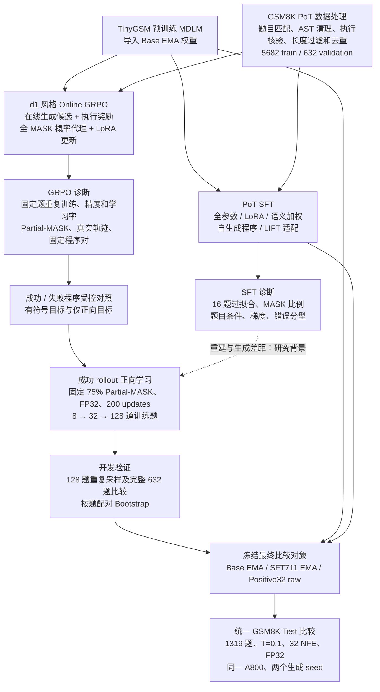
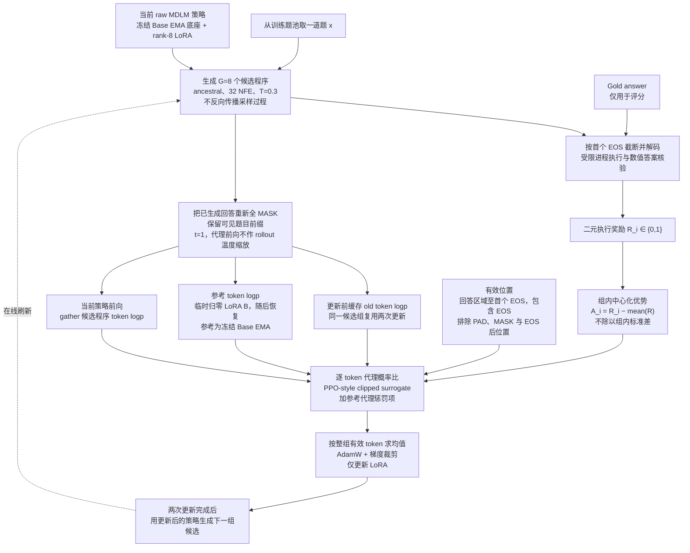

# TinyGSM MDLM：方法示意图

本文件使用 Mermaid，可直接嵌入实验报告。三张图分别对应大纲的研究流程、MDLM 去噪过程和 Online GRPO 适配方法。方法图与 Fig. 1–7 的实验数据图独立编号，不改变已有图表编号。

## 示意图 A：整体研究流程

**图注：**实验从同一预训练 Base EMA 出发，先后研究 SFT、在线执行奖励优化及固定成功程序正向学习。箭头表示实验推进或比较关系；Positive Learning 从 Base EMA 重新初始化，不从失败的 SFT 或在线 GRPO checkpoint 续训。32题模型进入最终比较；128题扩量未显示额外可确认收益。632题为多轮使用的开发验证集，Test也有历史探索性使用。

## 示意图 B：MDLM 条件去噪与训练—生成区别

```mermaid
flowchart TB
    subgraph Train["训练：参考程序的随机 MASK 去噪"]
        T0["训练输入<br/>BOS + question + separator + program + EOS + PAD"]
        T1["采样噪声时间 t<br/>根据噪声日程遮盖目标 token"]
        T2["题目前缀可见<br/>程序区域为可见 token 与 MASK 的混合"]
        T3["DiT MDLM 前向<br/>预测原始 token 分布"]
        T4["按实际配置计算 MDLM 去噪目标<br/>区别 docstring / code / EOS / PAD<br/>更新全参数或 LoRA"]
        T0 --> T1 --> T2 --> T3 --> T4
    end
    subgraph Generate["生成：无参考程序条件下的 ancestral 采样"]
        G0["输入题目前缀<br/>BOS + question + separator"]
        G1["回答区域初始化为全 MASK<br/>总上下文长度 512"]
        G2["当前 token 状态 + 噪声水平<br/>DiT 预测 token 分布"]
        G3["按反向后验随机采样<br/>恢复部分 MASK token"]
        G4["重新固定原题目前缀<br/>进入下一去噪时间步"]
        G5{"完成预设去噪步数？"}
        G6["取生成区域、按首个 EOS 截断<br/>解码并执行评分"]
        G0 --> G1 --> G2 --> G3 --> G4 --> G5
        G5 -- "否" --> G2
        G5 -- "是" --> G6
    end
```

**图注：**MDLM 使用吸收态 MASK corruption；随机 MASK 训练时可能看到参考程序的一部分，而完整生成从未知回答区域开始。生成中题目前缀始终固定，已揭示token在本项目吸收态后验中保持不变。NFE表示模型前向次数，最终比较采用32 NFE；图中不意味着每步恢复相同数量token，也不按首次生成EOS提前停止整条去噪链。SFT通常保留EMA用于生成，在线GRPO使用当前raw策略。

**输入格式说明：**separator为配置中实际编码的分隔字符串，并非另设一个名为`[SEP]`的特殊token。512是本实验使用的总上下文长度，可生成空间等于512减去题目前缀长度。参考答案不进入策略输入。PAD是否参与SFT损失取决于实验配置，不能将所有SFT分支画成同一loss mask。

## 示意图 C：d1 风格 Online GRPO 的 MDLM 适配

**图注：**本图对应最初的全MASK在线GRPO实现。old/ref分数在组内更新前缓存；current分数随LoRA更新变化。计算策略比率和参考项时使用生成token的局部条件概率代理，没有计算完整多步生成轨迹likelihood。训练关闭dropout但启用梯度。后续Partial75在线消融修改代理输入及评分位置，不改变上述执行奖励来源。

实际目标为：

$$
\ell_{\theta,i,j}=\log p_\theta(y_{i,j}\mid x_i,[\mathrm{MASK}]^L),\qquad
r_{i,j}=\exp(\ell_{\theta,i,j}-\ell_{\mathrm{old},i,j}),
$$

$$
\delta_{i,j}=\ell_{\mathrm{ref},i,j}-\ell_{\theta,i,j},\qquad
K_{i,j}=\exp(\delta_{i,j})-\delta_{i,j}-1,
$$

$$
L=\operatorname{mean}_{(i,j)\in V}\left[
-\min\!\left(r_{i,j}A_i,\operatorname{clip}(r_{i,j},1-\epsilon,1+\epsilon)A_i\right)
+\beta K_{i,j}\right].
$$

主在线实验使用$\epsilon=0.2$、$\beta=0.04$。这里的$K$是候选token上的参考代理项，不是完整序列或完整词表KL；$r$也不能解释为完整采样策略的精确重要性比率。组内全对或全错时策略优势为零，但参考项仍可能产生梯度。

**与Positive Learning的区别：**正向学习使用预先筛选的固定成功程序、固定75%训练MASK，以及4套独立MASK进行评分；每次更新不刷新在线rollout，不使用负优势、clipping或参考KL。独立MASK仍作用于相同训练程序，不表示独立测试题。该方法应单独介绍，不能直接标为“成功的Online GRPO”。

## 实现依据

- [MDLM与采样实现](../../s-flm/samplers.py)：ancestral状态更新及题目前缀固定。
- [GRPO目标实现](../../s-flm/diffu_grpo.py)：有效位置、组内优势、概率代理、参考适配器和clipped loss。
- [在线训练入口](../../s-flm/scripts/train_mdlm_grpo.py)：候选生成、执行奖励及LoRA更新。
- [Positive32运行说明](../../s-flm/docs/mdlm_grpo_positive32.md)：固定成功程序正向学习的目标与评估边界。
